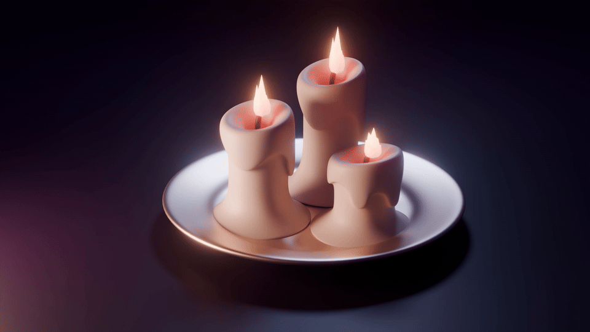

# 🕯️ Candles — Candele che si sciolgono



Tre candele stilizzate che si sciolgono su un piatto, in una scena scura illuminata dal bagliore delle fiamme.
Il progetto segue un tutorial realizzato con **EEVEE Legacy**, adattato alle impostazioni del nuovo EEVEE di **Blender 5.2 LTS**.

---

## 📋 Dettagli

| | |
|---|---|
| **Software** | Blender 5.2.4 LTS |
| **Motore di render** | EEVEE |
| **Risoluzione** | 2560 × 1440 |
| **Animazione** | 120 frame, in loop |
| **Tutorial di riferimento** | [Titolo del tutorial](LINK_DEL_VIDEO) di AUTORE |

---

## 🛠️ Workflow

### 1. Modellazione
- Corpo delle candele modellato partendo da un **Round Cube**
- Cima scavata attorno allo stoppino, **colature** e base allargata per l'effetto cera sciolta
- **Fiamme** e **stoppini** come oggetti separati
- **Piatto** su cui poggiano le tre candele

### 2. Materiali
**Cera**: Principled BSDF con Subsurface Scattering
- Weight `1.0`, Scale `0.5`, Radius `1.0 / 0.2 / 0.1`
- Base Color pesca chiaro (sostituisce la vecchia *Subsurface Color*, rimossa da Blender 4.0)

**Fiamme**: emissione con sfumatura verticale
```
Texture Coordinate (Generated) → Mapping (Rotation Y 90°) → Gradient Texture (Linear) → Color Ramp → Emission Color
```

**Piatto**: materiale bianco lucido

### 3. Luci e render
- Scena scura con sfondo freddo, in contrasto con la luce calda delle fiamme
- **Raytracing** attivo per riflessi più realistici
- **Bloom** con il nodo **Glare** (tipo *Bloom*) nel Compositor, visibile anche in viewport con *Compositor: Always*
- **Depth of Field** dalla camera per sfocare lo sfondo

---

## 🔄 Da EEVEE Legacy a Blender 5.2

Il tutorial usa impostazioni che dalla 4.2 sono state spostate o rimosse. Ecco come le ho convertite:

| Nel tutorial (EEVEE Legacy) | In Blender 5.2 |
|---|---|
| Bloom | Nodo **Glare → Bloom** nel Compositor |
| Screen Space Reflections | **Render Properties → Raytracing** |
| Ambient Occlusion | **Raytracing → Fast GI Approximation** |
| Volumetrics | **Volumes** |
| Subsurface Color | **Base Color** |
| Subsurface `0.5` | **Weight** `1.0` + **Scale** `0.5` |
| Subsurface Translucency (materiale) | Non serve più, funziona in automatico |

---

## 📁 Struttura della cartella

```
Candles/
├── Candles.blend
├── Renders/
│   ├── candles_loop.mp4
│   ├── candles_loop.gif
│   └── candles_render.png
└── README.md
```

> Il file `.blend` è tracciato con **Git LFS**.

---

## 🚀 Prossimi passi

- [ ] **Point Light** arancio in ogni fiamma, così le fiamme diventano la vera fonte di luce della scena
- [ ] Ombra disattivata sugli oggetti fiamma (*Ray Visibility → Shadow*)
- [ ] Color Ramp della fiamma rifatta: giallo-bianco alla base → arancio-rosso in punta
- [ ] **Rim light** blu dietro le candele per staccarle dallo sfondo
- [ ] Piatto più liscio (*Subdivision Surface* + *Shade Auto Smooth*)
- [ ] Pozze e gocce di cera sul piatto
- [ ] Colature più varie con **Sculpt Mode**
- [ ] Leggera volumetria per rendere visibile la luce nell'aria
- [ ] **Animazione in loop** con fiamme tremolanti (modificatore *Noise* nel Graph Editor) → video e GIF
- [ ] Rinominare gli oggetti (`Roundcube.00x` → `Candela_1`, `Fiamma_1`, …)

---

## 💡 Cosa ho imparato

- Come convertire un tutorial di **EEVEE Legacy** nel nuovo EEVEE (bloom nel compositor, raytracing al posto di SSR e AO)
- Come funziona il **Subsurface Scattering** nel nuovo Principled BSDF e perché il colore ora arriva dalla Base Color
- Come creare una **sfumatura di colore** su un oggetto con Mapping, Gradient Texture e Color Ramp
- Come usare il **Compositor** anche in viewport per vedere il bloom in tempo reale
