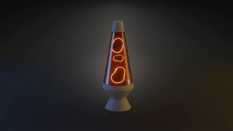

# Lava Lamp

Lampada lava animata realizzata in Blender: blob di metaball che salgono e scendono dentro un vetro trasparente, con bagliore e illuminazione a due toni (blu e arancio).



🎬 **Video completo:** [Renders/lava-lamp.mp4](Renders/lava-lamp.mp4)

---

## Dettagli tecnici

| | |
|---|---|
| **Software** | Blender 5.2.3 LTS |
| **Motore di render** | EEVEE |
| **Risoluzione** | 1920 × 1080 |
| **Frame rate** | 30 fps |
| **Durata** | 10 secondi (300 frame) |
| **Output** | MP4 · H.264 |

---

## Come è fatto

### Modellazione
- Corpo della lampada costruito da un cilindro, sagomato con scalature sugli edge loop (base, cono centrale e vetro).
- Il vetro è un oggetto separato (`Glass`), così da poter avere un materiale dedicato.

### Blob di lava
- I blob sono **metaball** (`Mball`) istanziate da un **sistema di particelle** sull'oggetto `Emitter`: quando due metaball si avvicinano si fondono, come la cera vera.
- Il movimento è guidato da **force field** (`Turbulence`, `Wind`, `Wind.001`).
- L'oggetto `Bounds` ha la forma interna della lampada e fa da **contenitore con Collision**, così le particelle rimbalzano senza uscire dal vetro. È escluso dal render.

### Materiali
- **Blob:** `Fresnel → Color Ramp → Mix Shader` tra un *Principled BSDF* (con Subsurface per l'effetto cera) e un nodo *Emission* (Strength 20). I bordi emettono luce, il centro resta morbido e lattiginoso.
- **Vetro:** `Fresnel → Mix Shader` tra *Transparent BSDF* e *Glossy BSDF*, con Render Method *Blended*: trasparente al centro, riflettente sui bordi.

### Illuminazione e post-produzione
- Tre area light: `Area blue`, `Area orange` e `Back Area` per il contrasto freddo/caldo e il controluce.
- **Bloom** ottenuto nel Compositor con il nodo *Glare* in modalità Bloom.

---

## Adattamento da EEVEE Legacy

Il progetto segue un tutorial realizzato con il vecchio EEVEE. Queste sono le impostazioni che nelle versioni nuove sono cambiate e come le ho sostituite:

| Nel tutorial (EEVEE Legacy) | In Blender 5.x (EEVEE Next) |
|---|---|
| Bloom nelle Render Properties | Compositor → nodo **Glare** (Bloom) |
| Ambient Occlusion | Integrato nel pannello **Raytracing** |
| Screen Space Reflections / Refraction | **Raytracing** + **Raytraced Transmission** nel materiale |
| Blend Mode | **Render Method** (Dithered / Blended) |
| Subsurface Color, Transmission Roughness | Rimossi dal Principled BSDF |
| FFmpeg tra i File Format | Output → **Media Type: Video** |

---

## Struttura della cartella

```
Lava-Lamp/
├── Lava-Lamp.blend
├── README.md
└── Renders/
    ├── lava-lamp.mp4
    └── lava-lamp.gif
```

---

## Prossimi passi

- [ ] Dare un colore alla lava (Principled ed Emission dello stesso colore)
- [ ] Aggiungere una Point Light dentro la lampada per illuminare vetro e scena
- [ ] Liquido colorato con una tinta leggera nel Transparent BSDF
- [ ] Rendere il video un loop perfetto (primo e ultimo frame uguali)
- [ ] Spostare gli oggetti di servizio (Bounds, Emitter, force field) in una collection *Helpers*
- [ ] Versione in Cycles per confrontare vetro e Subsurface

---

## Crediti

Tutorial seguito: [titolo del video](link-al-video)
