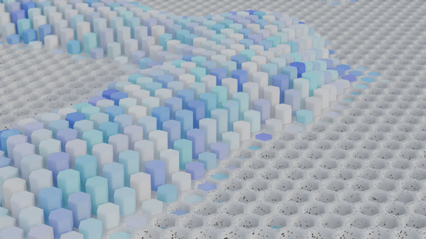

# Procedural Pin Art



Animazione in loop di una griglia esagonale di "pin" che salgono e scendono come nel giocattolo **Pin Art**, realizzata interamente con **Geometry Nodes** in Blender 5.2 LTS.

🎬 [Video in alta qualità (MP4)](Render/pin_loop.mp4)

---

## Come funziona

Tutto il progetto è un unico modificatore Geometry Nodes applicato a un Plane. Il node tree è diviso in tre parti.

### 1. Griglia esagonale

- **Grid** → **Triangulate** → **Transform Geometry** (rotazione 45°) → **Dual Mesh** genera una mesh a celle esagonali.
- **Set Position** con `Position × (1, 1.732, 1)` corregge le proporzioni e rende gli esagoni regolari.
- **Face Neighbors** + **Equal (= 6)** seleziona solo gli esagoni completi, scartando i pezzi irregolari sul bordo.
- **Extrude Mesh** + **Scale Elements (0.76)** crea i fori in cui scorrono i pin.

### 2. Base

- **Separate Geometry** divide i fori (che diventano i pin) dal resto della superficie (la base).
- **Extrude Mesh** (0.28) dà spessore alla base.
- **Merge by Distance** → **Mesh Bevel** (5 segmenti) arrotonda i bordi.
- **Bake** (Still) congela il risultato del bevel, che è l'operazione più pesante, così il viewport resta fluido durante il playback.
- **Set Material** + **Set Shade Smooth**.

### 3. Pin animati

- **Mesh to Points** (sulle facce) → **Instance on Points** con un cilindro preso da **Object Info**.
- Un **Noise Texture 4D** genera il movimento, rimappato da un **Map Range** (Smooth Step) per decidere quanto i pin scendono e quanto salgono.
- **Set Position** sposta ogni pin in Z in base al valore del noise.

---

## Il loop perfetto

Un noise fatto scorrere linearmente nel tempo non torna mai al punto di partenza, quindi il video non può andare in loop.

Per risolverlo il punto di campionamento del noise **si muove su un cerchio** nelle due dimensioni libere: Z (la griglia è piatta, quindi Z non è usata) e W (la quarta dimensione del noise 4D). Dopo un giro completo il noise torna identico al primo frame.

```
θ = (Frame / 250) × 2π

Vector = Position + (0, 0, r · cos θ)
W      = r · sin θ
```

| Parametro | Valore | Effetto |
|---|---|---|
| Durata loop | 250 frame (~10,4 s a 24 fps) | deve coincidere con il frame range della scena |
| Raggio `r` | 0.8 | più alto = pattern che cambia di più durante il loop |
| Noise Scale | 0.4 | più basso = "isole" di pin più grandi |
| Map Range | From 0.3–0.7, Smooth Step | quanta superficie resta piatta e quanto salgono i pin |

---

## Render

L'animazione è stata renderizzata dal viewport in **Material Preview** con **Render Playblast** (View › Render Playblast) e poi convertita con ffmpeg.

```bash
# Image sequence → MP4
ffmpeg -framerate 24 -i %04d.png -vf "scale=1920:1080:flags=lanczos" -c:v libx264 -pix_fmt yuv420p -crf 18 pin_loop.mp4

# MP4 → GIF con palette ottimizzata
ffmpeg -i pin_loop.mp4 -vf "fps=20,scale=720:-1:flags=lanczos,split[a][b];[a]palettegen[p];[b][p]paletteuse" -loop 0 pin_loop.gif
```

- Camera bassa e radente alla superficie, con **Depth of Field** (F-Stop basso) messo a fuoco su un Empty.
- Overlay disattivati e viewport samples aumentati prima del playblast.

---

## Struttura della cartella

```
Procedural Pin Art/
├── Pin-Art.blend
├── README.md
└── Render/
    ├── pin_loop.mp4
    ├── pin_loop.gif
    └── Frame/          # image sequence PNG (esclusa da Git)
```

---
